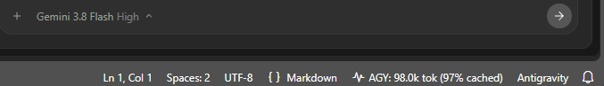

# Antigravity Context Monitor

Minimal, real-time context token counter in the VS Code status bar for Antigravity sessions.



## Highlights

- **Live Status Bar Counter**: Real-time token count and cache percentage (`AGY: 98.0k tok (97% cached)`).
- **Zero Overhead**: Streams directly from local session transcripts with no external runtime dependencies.
- **Detailed Tooltip**: Hover to view fresh input, cache read, output tokens, and step numbers.
- **Workspace Aware**: Automatically follows the active Antigravity chat in your current workspace.

## Installation

Download the latest `.vsix` from [GitHub Releases](https://github.com/bukowa/vscodeagtokentab/releases) and install:

```bash
code --install-extension vscodeagtokentab-<version>.vsix
```

## Commands

| Command | Identifier | Description |
| :--- | :--- | :--- |
| **Refresh Context Monitor** | `antigravityMonitor.refresh` | Re-syncs with the active conversation. |
| **Open Raw Transcript** | `antigravityMonitor.openTranscript` | Opens the current `transcript.jsonl` log. |

## Development

```bash
# Compile and bundle
npm run build

# Run unit tests
npm test

# Package VSIX locally
npm run package
```

## License

MIT
